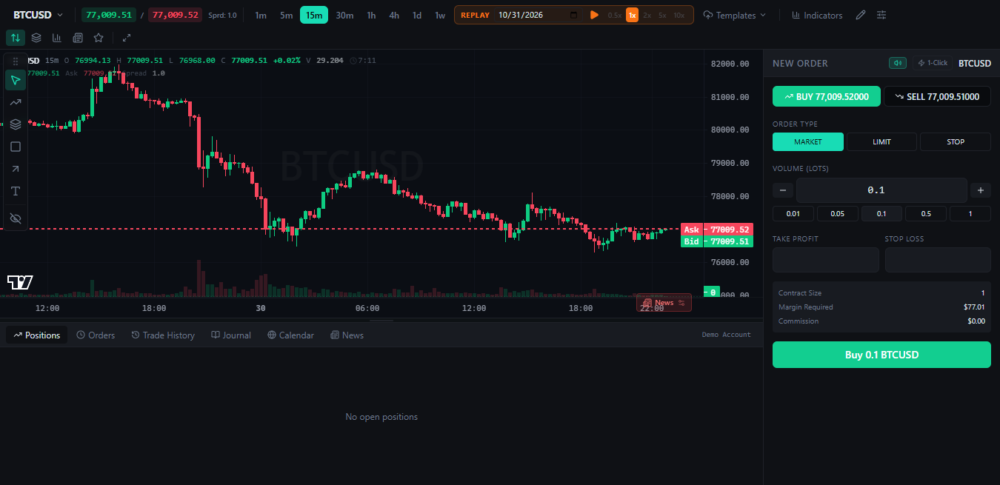
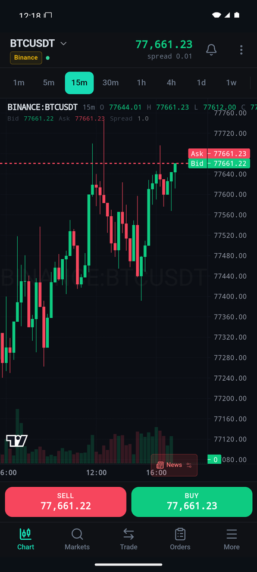
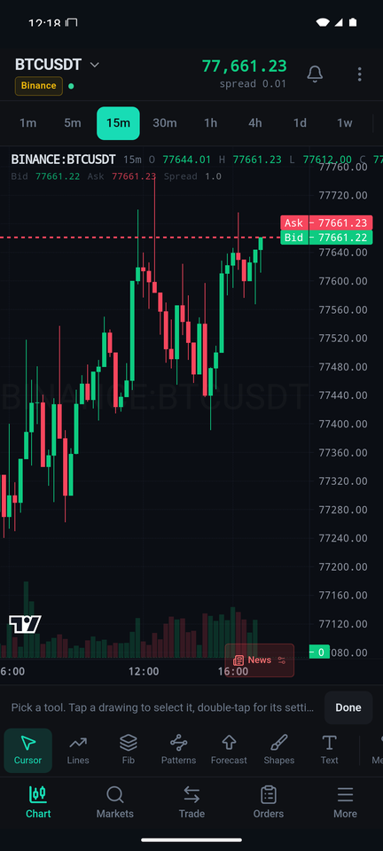
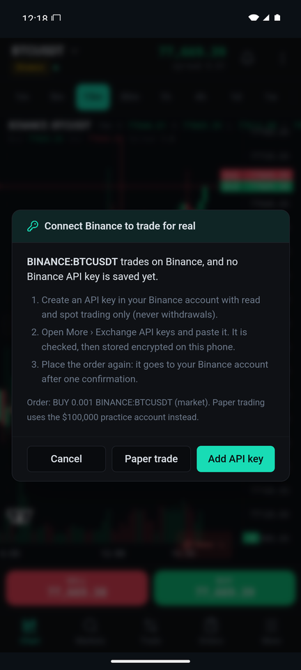
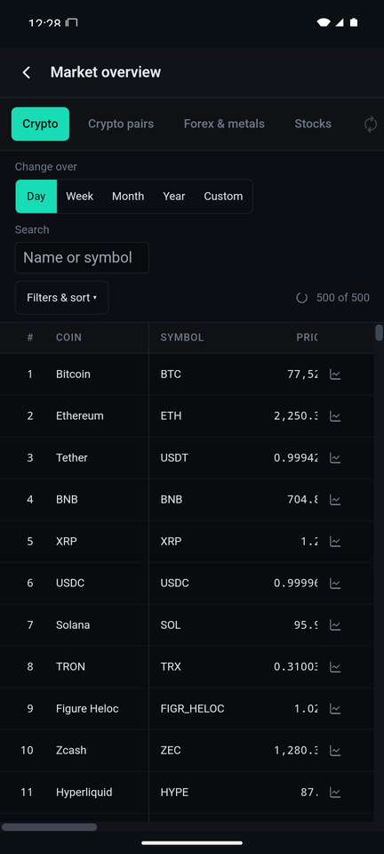
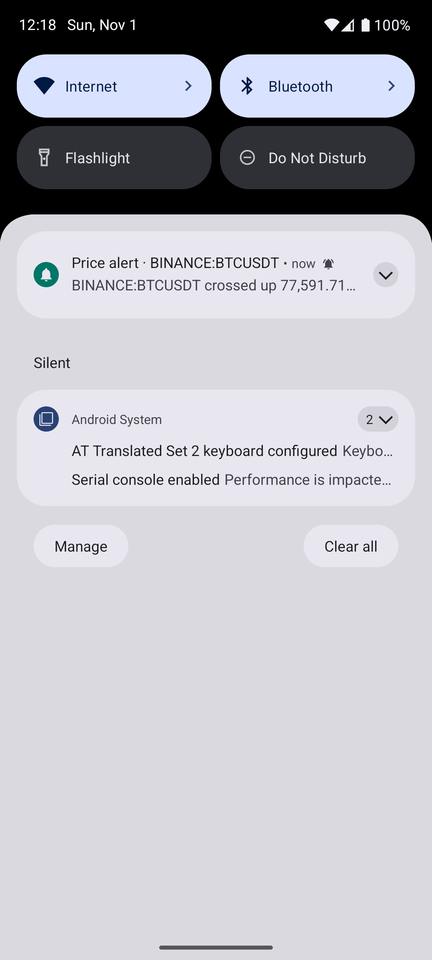

# OpenCharts Desktop & Android

Trading charts for Windows and Android, built on the open-source [OpenCharts](https://github.com/dylanpersonguy/OpenCharts) terminal and TradingView Lightweight Charts™.
Live prices from six crypto exchanges, DEX tokens on every chain, forex and spot gold; real trading through your own exchange API keys or a $100,000 paper account; price alerts; portfolio, market overview and alerts & positions dashboards; 80+ TradingView-style drawing tools.

No account, no server: the apps talk to the exchanges' public APIs directly, and your API keys stay encrypted on your own device.

> Unofficial. Not affiliated with OpenCharts, TradingView or any exchange. Not financial advice.



| Chart | Markets | Drawing tools | Order gate | Market overview | Alert |
|:-----:|:-------:|:-------------:|:----------:|:---------------:|:-----:|
|  |  |  |  |  |  |

*Android screenshots: the release app on an Android 15 emulator with live prices.*

## Download

Get the latest build from [Releases](../../releases/latest):

| App | File | Install |
|:----|:-----|:--------|
| Windows | `OpenCharts-0.6.0-portable.exe` | Run it; nothing to install. SmartScreen may warn on first run (More info › Run anyway): the exe is not code-signed. |
| Android 7.0+ | `OpenCharts-0.6.0.apk` | Open it on the phone and allow installs from that app once. Not on Google Play; Play Protect may offer to scan it. |

## Features

| | Desktop | Android |
|:--|:--|:--|
| Crypto: busiest 120 USD pairs on Binance, OKX, Bybit, KuCoin, Coinbase, MEXC | ✓ | ✓ |
| DEX pools on every chain (GeckoTerminal search by name, ticker or contract) | ✓ | ✓ |
| Forex (43 pairs) and spot gold, silver, platinum, palladium, no signup | ✓ | ✓ |
| Optional OANDA v20 feed and trading | ✓ | ✓ |
| Real spot orders with your API keys, with a confirmation before sending | ✓ (Windows DPAPI) | ✓ (Android Keystore) |
| Paper trading with take profit, stop loss, live P&L | ✓ | ✓ |
| Price alerts (once or every time), notifications | ✓ Windows | ✓ Android |
| Portfolio: exchange balances, open orders, on-chain wallets | ✓ | ✓ |
| Market overview: 1,000 coins, 2,400 pairs, forex, 500 stocks, custom conditions | ✓ | ✓ |
| 8 indicators, 80+ drawing tools, templates, replay, journal | ✓ | ✓ (touch drawing bar) |

Details: [desktop/README.md](desktop/README.md) and [android/README.md](android/README.md).

## Repository Layout

```text
├── upstream/    OpenCharts terminal (React + Vite), shared by both apps, with marked patches
├── adapters/    Market data and order adapters: exchanges, GeckoTerminal, forex, OANDA, wallets
├── desktop/     Windows app (Electron): main process, exchange signing, keys, menus, smoke tests
├── android/     Android app (Capacitor): bridge to desktop/electron modules, native plugin, phone UI tooling
└── docs/        Screenshots
```

Both apps run the same terminal and adapters.
The Android app runs the desktop app's main-process modules (`desktop/electron/`: exchange signing, OANDA, forex, GeckoTerminal) inside its WebView, through a small native plugin for HTTPS and the Android Keystore.
The phone layout lives in `upstream/src/mobile/` and switches on only inside the Android app.

`upstream/` was added with `git subtree` from OpenCharts commit `d3fc63c`; the commits after it show every patch.

## Build From Source

Needs Node.js 22.6 or newer.

### Windows desktop

```bash
cd desktop
npm install
npm run build:web
npm test
npm start
```

`npm run dist` builds `desktop/dist/OpenCharts-<version>-portable.exe`.

### Android

Also needs JDK 21 and the Android SDK (platform 36, build-tools 35); see [android/README.md](android/README.md#build-from-source).

```bash
cd android
npm install
npm test
node dev/tools/build-apk.mjs
```

The APK is `android/dist/OpenCharts-<version>.apk`.
`npm run dev` runs the phone app in a browser at `http://localhost:5180` with live data.

### Terminal checks

```bash
cd upstream
npm ci
npx tsc --noEmit
npx eslint src/ --max-warnings=0
npx vitest run
```

## Security

- API keys are checked with the exchange, then stored encrypted (Windows DPAPI on desktop, AES-256-GCM under an Android Keystore key on Android). They are never shown again and never sent anywhere but the exchange.
- Create keys with **read** and **spot trading** permission only. Never enable withdrawals.
- Requests go only to an allowlist of hosts (the exchanges, data providers and public blockchain nodes).
- Real orders were tested up to each exchange's key check, not with funded accounts. Try a test-network key or a tiny order first.

Found a security problem? Open a private security advisory on this repository rather than a public issue.

## Credits

- [OpenCharts](https://github.com/dylanpersonguy/OpenCharts) by dylanpersonguy, MIT.
- TradingView Lightweight Charts™, Apache 2.0, Copyright (c) 2025 TradingView, Inc. <https://www.tradingview.com/>.
- Electron, Capacitor, @noble cryptography, and the data providers listed in [NOTICE](NOTICE).

## Licence

MIT for this project's code (see [LICENSE](LICENSE)); `upstream/` keeps OpenCharts' MIT licence and NOTICE.
