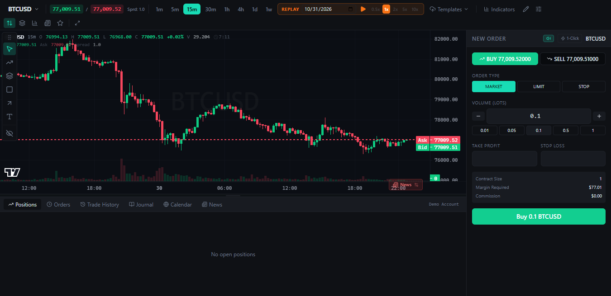

# OpenCharts Desktop

A Windows desktop trading-chart app with live prices from six crypto exchanges, DEX tokens, forex and gold.
It trades for real through your exchange API keys (or on a paper account), and has a portfolio and a market overview dashboard.
It wraps the open-source [OpenCharts](https://github.com/dylanpersonguy/OpenCharts) terminal in Electron.
Nothing to install: one portable exe.



## Markets

| Market | Source | Key needed | Updates |
|:-------|:-------|:-----------|:--------|
| Crypto: the busiest 120 USD pairs on each of **Binance, OKX, Bybit, KuCoin, Coinbase and MEXC** (`OKX:BTCUSDT`, `COINBASE:BTCUSD` …) | Each exchange's public API | No (API key only to trade) | Charted pair every second, the rest every 15 s |
| DEX pools on every chain (Ethereum, Solana, BSC, Base, …) | GeckoTerminal | No | Price every 15 s |
| Forex (43 pairs) and metals: **XAU/USD**, XAG/USD, XPT/USD, XPD/USD | Swissquote (prices) + Yahoo Finance (history) | No | Charted symbol every 2 s, the rest every 30 s |
| Or: forex (~70 pairs) and metals from OANDA v20 | OANDA | OANDA token (optional) | Live stream |

DEX prices are the pool's base token in USD.
Forex and metal prices are live spot bid/ask (XAU/USD is spot gold).
Without OANDA, metal **history** comes from the front-month futures (gold `GC=F`), scaled to the live spot price, so older candles can differ from true spot by a few dollars.
With an OANDA token, forex and metals come from OANDA instead.

## What It Does

- Candlestick charts from 1m to 1w, with 8 indicators, replay, watchlist, depth ladder, trade journal and chart templates.
- **TradingView's drawing tools** on a left rail grouped like TradingView's (below), plus measure, zoom, magnet, stay in drawing mode, lock all, hide all and remove all.
- **Six exchanges** switchable in **Data › Live prices**. Pairs are named like TradingView (`BYBIT:SOLUSDT`); the symbol picker and watchlist tag every pair with its exchange (OANDA for forex and metals, DEX for pools) and have one chip per venue to filter by.
- **Real trading with API keys** (Data › Exchange API keys, or the OANDA token for forex and metals). Without a key, placing an order opens a reminder that walks you to the keys window, or lets you paper trade that order. With a key, every order shows a confirmation with the exchange's own pair, rounded quantity and estimated value before it is sent.
- **File › Dashboard › Portfolio**: balances and open orders (with cancel) on every exchange with a key and on OANDA, plus on-chain wallets by address (EVM chains, Solana, Bitcoin), totals and allocation.
- **Price alerts**: right-click a price on the chart › **Set alert**; the **Alerts** tab under the chart lists them, each firing once or every time the price crosses, with a Windows notification, sound and toast.
- **File › Dashboard › Alerts & positions**: one window for every alert, every open position and order across the paper account, the exchanges and OANDA, with close and cancel.
- **File › Dashboard › Market overview**: Crypto (top 1,000 coins with their exchange pairs and DEX pools, plus trending DEX-only tokens), Forex & metals and Stocks (500 largest companies) tables, with changes over a day, week, month, year or custom dates, min/max ranges for volume, market cap and change, sorting both ways, and a custom condition over any column.
- **DEX search** inside the symbol picker: type a token name, ticker or contract address to search pools on every chain, sorted by liquidity; click one to add and chart it, or the bin icon to remove it.
- Paper trading (for pairs without a key, DEX pools and the demo) on a $100,000 simulated account against the live prices: market, limit and stop orders, take-profit and stop-loss, live P&L.
  Forex lots are 100,000 units, gold 100 oz, silver 5,000 oz; DEX lots are sized to about $100–$1,000.
  P&L on pairs not quoted in USD (USD/JPY, EUR/GBP) is converted to USD with OANDA's live rates.
- Remembers the last charted symbol, your DEX pools, drawings and chart settings.
- **Data** menu: **Live prices** (with a switch per exchange) or an offline demo (bundled history replayed); **Exchange API keys…**; **OANDA token…** switches forex and gold to OANDA and enables OANDA trading.

Orders go to an exchange only when its API key is saved and you confirm the order. Everything else is paper trading, and the paper account resets when the app closes.

## Usage

1. Download `OpenCharts-0.6.3-portable.exe` from the [Releases](../../../releases/latest) page (or build it, below) and double-click it. Copy it anywhere; it is one self-contained file.
2. Click the symbol name (top left) to switch markets. Type to filter, for example `okx btc`, `gold`, `EUR` or `pepe`, or click an exchange chip.

Forex and gold work with no setup.

### Drawing Tools

Click a group's icon to use its last tool, or the small arrow beside it for the full list.

| Group | Tools |
|:------|:------|
| Trend line tools | Trendline, ray, info line, extended line, trend angle, horizontal line and ray, vertical line, crossline; parallel channel, regression trend, flat top/bottom, disjoint channel; pitchfork, Schiff, modified Schiff, inside pitchfork |
| Fib & Gann | Fib retracement & extension (one tool: levels 0–1 plus 1.272, 1.618, 2.618), fib channel, fib time zone, speed resistance fan, trend-based fib time, fib circles, spiral, speed resistance arcs, fib wedge, pitchfan; Gann box, Gann square fixed, Gann square, Gann fan |
| Patterns | XABCD, cypher, head and shoulders, ABCD, triangle, three drives; Elliott impulse, correction, triangle, double and triple combo; cyclic lines, time cycles, sine line |
| Forecasting and measurement | Long and short position, position forecast, bars pattern, ghost feed, sector; anchored VWAP, fixed range and anchored volume profile; price range, date range, date and price range |
| Geometric shapes | Brush, highlighter; arrow marker, arrow, arrow mark up and down; rectangle, rotated rectangle, path, circle, ellipse, polyline, triangle, arc, curve, double curve |
| Annotation | Text, note, price note, pin, table, callout, comment, price label, signpost, flag mark |

Placing: click once per point (or press, drag and release for the first two).
Path, polyline and ghost feed take any number of points: double-click or press Enter to finish; clicking a polyline's first point closes it.
Brush and highlighter paint while you drag.
Double-click a drawing for its settings (colour, width, style, fill, text); text tools take their text there, and a table's cells are separated by `|`, its rows by new lines.
Shortcuts: Alt + T trendline, Alt + H horizontal line, Alt + J horizontal ray, Alt + V vertical line, Alt + C crossline, Alt + F fib retracement & extension, Alt + R rectangle, Alt + M measure.

### Real Trading With API Keys

1. Create an API key on the exchange with **read** and **spot trading** permission only. Never enable withdrawals. Restricting it to your IP address is safer still.
2. **Data › Exchange API keys…**, pick the exchange, paste the key and secret (plus the passphrase for OKX and KuCoin; for Coinbase the CDP key name and private key), **Check and save**.
3. The key is checked by reading your balances, then stored encrypted with Windows DPAPI in `%APPDATA%\OpenCharts\settings.json`. It stays in the main process; the page only learns whether a key exists.
4. Place orders as usual (order panel, one-click, watchlist). Each real order shows a confirmation first; cancel there and nothing is sent.

Binance (testnet.binance.vision), OKX (demo trading) and Bybit (testnet) keys can be marked as test keys: orders then go to the test account and the confirmation says so.
If the exchange refuses the key, the keys page lists the usual causes and the public IPv4 address the exchange sees (read from api.ipify.org only at that moment), for keys with an IP restriction.
A Binance testnet key saved without the test box ticked, or the other way round, is found on the other network and saved as such (OKX and Bybit too).
Binance keys are checked for shape first: a system-generated key and secret are 64 letters and digits, so a key cut short in pasting is caught before Binance is asked.
Real orders are market or limit spot orders. Quantities are coins (the order panel shows **Quantity (BTC)**), rounded down to the pair's lot step and checked against its minimum.
Take profit and stop loss are sent with OANDA orders only; stop orders stay paper.
Real fills do not appear in the terminal's positions table: see **File › Dashboard › Portfolio** for balances and open orders.

### Price Alerts

1. Right-click the price you care about on the chart and choose **Set alert on … at …** (or type a symbol and price in the **Alerts** tab under the chart and press **Add alert**).
2. In the **Alerts** tab choose **Once** (stops after it fires) or **Every time** (fires on every crossing, at most once a minute). Click the condition to change the price; the note field takes any text.
3. When the price crosses, a Windows notification appears (click it to chart the pair), with a beep and a toast. The **Log** view keeps the last 200 firings.

Alerts work on any listed symbol and survive restarts. They are checked while the app runs: a crossing while it was closed fires at the next start. Email or phone notifications while the app is closed would need something running elsewhere and are not built yet.

### Alerts & Positions

**File › Dashboard › Alerts & positions** (Ctrl+Shift+A) opens a central window: summary cards, the full alert list, open positions (paper account and OANDA trades, each with **Close**), open orders on the paper account, every exchange with a key and OANDA (each with **Cancel**), and exchange holdings.
The paper account and alert checks run in the main window; the dashboard says so if that window is not running.

### Portfolio-Only Exchanges

**HTX (Huobi), WhiteBIT, Gate.io, HitBTC and Poloniex** take an API key in the same window for the portfolio only: balances, open orders and **Cancel**.
They have no price feed or order ticket in OpenCharts; place orders on the exchange's own site.
A **read** key is enough; cancelling needs trade permission.
BitMEX is not offered: it closed its exchange on 23 September 2026.

### Portfolio

**File › Dashboard › Portfolio** (Ctrl+Shift+P) opens in its own window and refreshes every minute.
Exchanges and OANDA show balances with USD values and open orders with **Cancel**; venues without a key show **Connect …** buttons.
Paste any wallet address to track it read-only: `0x…` addresses are read on Ethereum, BNB Chain, Base, Arbitrum, Polygon, Optimism and Avalanche; Solana and Bitcoin addresses are detected too.

### Market Overview

**File › Dashboard › Market overview** (Ctrl+Shift+M) opens in its own window.
Pick **Day, Week, Month, Year** or **Custom** (from and to dates); the Change column follows it.
Volume, market cap and change take min and max values with K, M, B, T suffixes (`10M`, `1.5B`).
Click a column header (or use Sort) for high → low and again for low → high.
The **Condition** box filters on any column, for example `change > 5 and volume > 50M and not symbol contains "usd"` or `pe < 25 and div_yield > 1`; the ? button lists the columns.
The **Chart** column at the right draws each row's price line over the chosen period (day, week, month, year or the custom dates), green when it ended higher and red when lower, so you can scan for breakouts while scrolling.
Day, week and month lines are intraday (15-minute, hourly and 4-hour bars; CoinGecko's 7-day line for coins), year and custom lines are daily closes; only rows on screen load theirs, and Refresh redraws them.
Click a row's chart to open that pair in the main window.
The **Crypto** tab shows where each coin trades, centralised and decentralised:
- **Exchanges**: the exchanges switched on that list the coin (`BIN OKX BYB KUC CB MEXC`), matched by ticker; the row chart and its click use the busiest pair.
- **DEX liquidity**, **DEX vol 24h**: totals over the coin's DEX pools on Ethereum, Solana, BNB Chain, Base, Arbitrum, Polygon, Avalanche, Optimism, TON, Sui and Tron (DexScreener, matched by contract address; BTC, ETH, SOL, BNB and AVAX through their wrapped tokens). They load for the rows on screen, so sorting on them covers the rows already scrolled past.
- **CEX/DEX gap**: how far the most liquid DEX pool's price is from the busiest exchange pair, in percent.
- Click a coin's name to open its venues: every exchange pair (price, 24h change, volume, spread) and its most liquid DEX pools (chain, DEX, pair, price, liquidity, volume), each with a **Chart** button.
- Trending pools from GeckoTerminal whose token is not among the 1,000 coins are added as **DEX only** rows (most have no market cap and sort last: filter with `exchanges contains "DEX only"`); their day lines are drawn at once from the pool's reported changes, while week and longer lines fill in slowly (GeckoTerminal's free API allows about five calls a minute).
- A DEX pool's **Chart** button adds the pool to the symbol list (like **DEX pools** in the symbol search) and charts it; when GeckoTerminal is busy the pool's bars can take half a minute.
- A DEX pool's **Trade** button opens that DEX's own swap page (Uniswap, PancakeSwap, Jupiter, Raydium, STON.fi, Cetus…) in your browser with the pair filled in. You connect your own wallet and trade there; OpenCharts does not see, sign or route the trade and charges nothing. Link formats: [docs/dex-trade-links.md](docs/dex-trade-links.md).
Try `change > 5 and dex_liq > 1M and exchanges contains "BIN"`, or sort by `CEX/DEX gap`.
The table is wider than most windows: drag the scrollbar under it, or hold Shift and turn the mouse wheel. The rank and name columns stay pinned.

### Optional: OANDA Instead

Only for OANDA v20 accounts; demo accounts that are MT4/MT5-only, or in OANDA Global Markets, have no API token.

1. Open a free practice account at [oanda.com](https://www.oanda.com/) (demo money, no deposit).
2. In the account portal open **Manage API Access** and generate a token.
3. In the app: **Data › OANDA token (forex & gold)…**, choose **Practice**, paste the token, **Save and connect**.

The token is checked with OANDA, then stored encrypted with Windows DPAPI in `%APPDATA%\OpenCharts\settings.json`.
It stays in the app's main process; the chart page never sees it.
**Remove token** in the same window deletes it.

## Files

| Path | What it is |
|:-----|:-----------|
| `dist/OpenCharts-<version>-portable.exe` | The app to run (built, not committed) |
| `electron/main.js` | Desktop shell: window, menus, `app://` file server, IPC bridges, token window, smoke mode |
| `electron/web.js` | Public requests for the page (exchange market data, overview, wallets), limited to an allowlist of hosts, paced per host |
| `electron/exchanges.js` | Request signing, order bodies and reply parsing for the six trading exchanges and the five portfolio-only ones; key checks |
| `electron/trade.js` | Exchange keys (DPAPI), balances, open orders, place and cancel; OANDA orders via `oanda.js` |
| `electron/keys.html` | The exchange API keys window |
| `electron/fx.js` | Keyless forex and metals: Swissquote quotes and a paced Yahoo Finance chart queue |
| `electron/oanda.js` | OANDA client in the main process: token (DPAPI), instruments, candles, price stream with reconnect |
| `electron/gecko.js` | GeckoTerminal request queue (under 30 calls/min, chart requests before price polls) |
| `electron/preload.cjs` | `window.ocDesktop`: the data calls the page may make |
| `electron/oanda-token.html` | The OANDA token window |
| `electron/lib.js` | Pure helpers: settings, paths, stream parsing, GeckoTerminal path allowlist |
| `../adapters/` | The page's combined adapter (shared with the Android app): exchanges (`cex-*`), GeckoTerminal, keyless forex (`fx-*`) and OANDA sources, the order router (`order-*`), venues, wallets, overview data and filters, plus pure mapping code |
| `../upstream/` | OpenCharts source at commit `d3fc63c` (2026-10-13), with the patches below (shared with the Android app) |
| `../upstream/src/lib/chart-plugins/drawing-tools/pro/` | The extra drawing tools: catalog, drawing code, and the pen that draws and hit-tests them |
| `web/` | The built terminal the shell loads (generated by `npm run build:web`) |
| `dev/tests/` | Unit tests for the shell helpers and the mapping code |
| `dev/tools/smoke.mjs` | Launches the real app per scenario: `live`, `retry`, `exchanges`, `gate`, `alerts`, `dash`, `dex`, `fx`, `forex`, `demo`, `draw` (and `oanda` on request) |
| `dev/tools/gallery.mjs` | Renders every extra drawing tool into `dev/out/gallery.html` for a visual check |
| `dev/tools/fake-oanda.mjs` | Local OANDA stand-in used by the `forex` smoke scenario |
| `LICENSE`, `NOTICE` | OpenCharts MIT licence and the TradingView Lightweight Charts notice |

## Build From Source

Needs Node.js 22.6 or newer (the tests run TypeScript directly) and an internet connection.

```bash
npm install
npm run build:web
npm test
npm run smoke
npm run dist
```

`npm start` runs the app from source after `build:web`.
`npm run smoke -- forex dex` runs chosen scenarios; screenshots go to `dev/out/`.
`npm run smoke -- draw` picks each extra drawing tool from the rail and places it with real mouse input.
`npm run smoke -- gate` places orders through the order router: the key reminder, paper trade, cancel, the keys window, and a made-up OKX key that must reach the confirmation and come back with OKX's rejection.
`npm run smoke -- alerts` right-clicks Set alert on the chart, makes two alerts fire on real prices (Windows notifications counted) and closes a paper position from the Alerts & positions window.
`npm run smoke -- dash` opens both dashboards, adds a public wallet address and walks every overview tab.
`node dev/tools/gallery.mjs` builds a page showing every extra drawing tool.
`npm run smoke -- oanda` checks the real OANDA service with the token saved in the app (never printed); it is not part of the default run.
Inside `../upstream/`: `npx tsc --noEmit`, `npx eslint src/ --max-warnings=0` and `npx vitest run` must stay clean.

## Upstream Patches

Every patch is marked `OpenCharts Desktop patch` in the code.

| File | Change |
|:-----|:-------|
| `src/Root.tsx` | `?adapter=` query parameter; uses `adapters/desktop-adapter.ts` inside the desktop app; mounts `DesktopSync` and `OrderGate`; `?view=portfolio|markets` renders a dashboard window |
| `src/desktop/` (new) | `DesktopSync` (symbol list refresh, last symbol, polled-feed interest, alert checks, dashboard snapshots, open-chart from dashboards, smoke hooks), `DexSearch`, `OrderGate` + `order-gate.ts` (key reminder and real-order confirmation), `VenueBadge`, `alerts-store.ts`, `AlertsPanel`, `TerminalAlerts`, `useAlertLines`, `desk-channel.ts`, `Dashboard`, `PortfolioPage`, `MarketsPage`, `DeskPage` |
| `src/pages/trading/ChartPanel.tsx`, `ChartContextMenu.tsx` | Right-click **Set alert** creates a stored alert; alert lines on the chart |
| `src/pages/trading/BottomPanel.tsx`, `src/pages/TradingPage.tsx` | **Alerts** tab |
| `src/lib/chart-plugins/drawing-tools/pro/` (new) | The extra drawing tools, stored as drawings of type `pro` with a `points` array |
| `drawing-tools/manager.ts` | Placement of pro tools (N clicks, multi-point, free-hand), point and body drags, copy/paste, zoom, bars-pattern capture; the measure tool shows a date-and-price range; Alt + J/V/C |
| `drawing-tools/resolve.ts`, `renderers.ts`, `hit-test.ts`, `types.ts` | Resolve, draw and hit-test pro drawings; volume series link; time between bars for brushes |
| `src/pages/trading/constants.ts` | `DrawingTool` includes the pro tools; `DrawingLine` gains `tool`, `points`, `closed`, `pattern` |
| `src/pages/trading/DrawingToolRail.tsx` | Rebuilt: TradingView's six groups with sectioned flyouts, measure, zoom, magnet, stay in drawing mode, lock/hide/remove all |
| `DrawingToolsOverlay.tsx`, `ObjectTreePanel.tsx` | Settings title, text and fill rows, and object-tree names for pro tools; style defaults per tool |
| `ChartPanel.tsx`, `TradingPage.tsx` | Rail toggles wired; volume series linked for VWAP and volume profiles |
| `src/__tests__/desktop-pro-tools.test.ts` (new) | Every extra tool draws and can be hit; readouts |
| `src/pages/trading/ChartToolbar.tsx` | Wider picker with names, multi-word search, venue chips and badges, 150-row cap, DEX search section, price badges use `getPipDigits` |
| `src/pages/trading/WatchlistPanel.tsx` | Groups by venue, venue badges, first 200 rows |
| `src/pages/trading/OrderPanel.tsx` | Buy/sell prices use the instrument's decimals instead of a fixed 5; crypto shows Quantity (coin) and skips the 1,000-lot cap |
| `src/pages/trading/utils.ts` | `tickSizeDecimals()`: exact decimals for tiny tick sizes |
| `src/pages/trading/MarketClosedBanner.tsx` | DEX pools count as 24/7 |
| `src/services/demo/instruments.ts` | `registerSymbols()` and `usdPerQuote()` so the paper engine trades any instrument in USD |
| `src/services/demo/engine.ts`, `src/lib/livePnl.ts` | Notional and P&L multiplied by `usdPerQuote()` |
| `src/__tests__/desktop-pip-digits.test.ts` (new) | Tests for the decimals fix |

To update OpenCharts: `git subtree pull --prefix upstream https://github.com/dylanpersonguy/OpenCharts main --squash` from the repository root, resolve the patches, run the checks above and `npm run smoke`.
The Android app's phone layout (`OpenCharts Mobile patch`) lives in the same tree; see [../android/README.md](../android/README.md#patches).

## Limits

- Alerts are checked only while the app runs (alerts on symbols that are not charted see a new price every 15–30 s); there is no email or phone delivery yet. Alerts on a symbol whose exchange is switched off never fire.
- **Real orders were tested up to the exchanges' key checks**, not with funded keys: signing matches Binance's published example and verifies locally for Coinbase; every exchange answered a signed request with a made-up key by rejecting the key (not the request format). Try a test-network key (Binance, OKX demo, Bybit) or a tiny order first.
- Real orders: market and limit spot only; no stop orders, and take profit / stop loss only on OANDA. Real fills are not in the terminal's positions table.
- The portfolio-only exchanges (HTX, WhiteBIT, Gate.io, HitBTC, Poloniex) were tested up to their key checks with made-up keys, like the others. Gate.io lists up to 100 open orders per pair, WhiteBIT and Poloniex the newest 100 and 2,000, HTX 500.
- MEXC lists open orders per pair, so the portfolio shows MEXC orders only for assets with funds on hold against USDT.
- Wallets: EVM chains show the native coin and main stablecoins and wrapped coins (every priced Ethereum token through Ethplorer's free key; thinly traded ones are hidden as likely spam); other tokens on BNB Chain, Base and the rest are not discovered.
- The overview uses free public APIs (CoinGecko, Yahoo Finance, exchange tickers) that can throttle; custom and week/month changes load daily history for the top 200 rows of the current view. Stocks are Yahoo's US-listed largest companies (with ADRs such as TSM).
- Each exchange lists its busiest 120 USD pairs; a pair outside that is not chartable (the overview's Crypto pairs tab shows 400 per exchange).
- Swissquote and Yahoo Finance are public, unofficial feeds with no service guarantee; if one changes or throttles, forex and gold stop updating or charting until fixed.
- Without OANDA, Yahoo keeps 1m history for 30 days and 5m–30m for 60 days; scrolling back further shows nothing at those timeframes. USD/THB and other pairs Swissquote does not quote are not listed.
- **OANDA was tested against a local stand-in** that follows OANDA's documented formats; the real service is checked only up to its login (it answers 401 without a token).
- Forex and metals close at the weekend (Friday 22:00 to Sunday 22:00 UTC); the chart then shows the last prices and a "market closed" banner.
- GeckoTerminal's free API allows 30 calls a minute, so DEX prices refresh every 15 s and deep scroll-back loads slowly. Prices smaller than 0.0000000001 show few digits (the terminal's 10-decimal limit).
- The chart's SL/TP drag labels and the order ticket's risk preview show non-USD-quoted pairs in the quote currency; positions and account balance are in USD.
- Paper margin uses 1:100 leverage for everything; with OANDA the ticket's "Margin Required" shows OANDA's own margin rate.
- Some exchanges block some countries (Binance and Bybit the US, for example). Switch a blocked exchange off in **Data › Live prices**, or use **Data › Offline demo**.
- The Calendar tab and technical gauge are TradingView embeds and need the internet; News shows sample headlines.
- Image, Post and Idea from TradingView's Content menu are not included (Post and Idea are TradingView's social features).
- The zoom tool zooms the time axis only; the price axis keeps auto-scaling.
- Drawings are saved per symbol in this app only; TradingView's cloud sync and alerts on drawings other than lines are not included.
- The exe is not code-signed, so Windows SmartScreen may warn on first run (More info › Run anyway).
- Not financial advice.

## Credits and Licences

- [OpenCharts](https://github.com/dylanpersonguy/OpenCharts) by dylanpersonguy, MIT.
- TradingView Lightweight Charts™, Apache 2.0. Copyright (c) 2025 TradingView, Inc. <https://www.tradingview.com/>. The chart keeps TradingView's attribution logo.
- DEX data: [GeckoTerminal](https://www.geckoterminal.com/) API. Forex and metals: [Swissquote](https://www.swissquote.com/) public quotes and [Yahoo Finance](https://finance.yahoo.com/) charts, or the [OANDA](https://www.oanda.com/) v20 API. Crypto: Binance public API.
